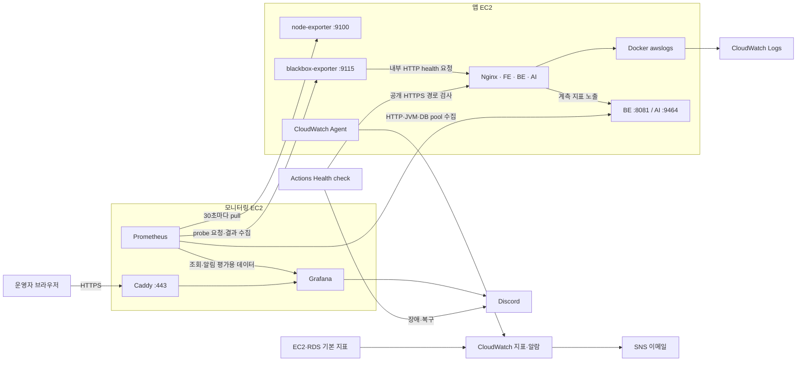

# 모니터링 전체 흐름과 구현·적용 현황

문서 대조일: **2026-10-15**. V1은 이 작업 브랜치의 설정 파일과 2026-10-01~02 운영 기록을, V2는 로컬 `origin/main`의 `92adfbc4fd7361412beb9eb1211e45610516bba0`에 있는 Terraform과 [개발 CD 작업 기록](v2-dev-cd-work-summary.md)을 확인했다. **이번 정리는 AWS·Grafana·SNS에 새로 접속해 현재 상태를 검증한 결과가 아니다.** 과거 적용 기록, 코드에 정의된 구성, 앞으로 할 일을 구분한다.

10월 15일 기록상 V1은 CloudWatch 앱 로그, 전용 EC2의 Prometheus·Grafana, 내부 health 및 BE·AI 기본 메트릭 수집까지 연결됐고 V2에는 ECS 로그·Container Insights·CloudWatch 알람을 만드는 Terraform이 있었다.

**후속 갱신(2026-10-21): 10월 20일 기존 모니터링 EC2에 V2 개발 BE·AI 메트릭 연결과 `[DEV]` 경보·복구 검증을 완료했다.** 적용 근거는 [개발 연결 작업 기록](dev-monitoring-connection.md) 11절을 따른다. 개발 로그는 현재 CloudWatch에서 조회하며 Grafana 로그 연동은 제안 단계다. **로그 검색·Live Tail·피어링 비용과 팀별 사용량 예시는 [모니터링 선택 검토](observability-selection-review.md) 15절**에 있다. 아래 본문의 기존 구성 설명은 10월 15일 기준이다.

## 1. 상세 문서는 어디에 있는가

| 읽을 순서 | 문서 | 찾을 수 있는 내용 |
| --- | --- | --- |
| 1 | 이 문서 | 전체 흐름, 코드와 적용 기록의 차이, V1/V2 경계, 남은 작업 |
| 2 | [V1 모니터링 운영 구성](v1-monitoring.md) | CloudFormation → 로그 활성화 → exporter → PG → HTTPS → 앱 메트릭 연결의 명령·포트·권한·복구 |
| 3 | [메트릭 계약 v1](monitoring-metrics-contract.md) | BE/AI 지표 이름, label, bucket, route/class, 초기 임계치와 인수 기준 |
| 4 | [앱 메트릭·알림 대응](monitoring-alert-runbook.md) | 설정 검사, 타깃 등록, 대시보드, firing→resolved 시험, 신호별 대응 |
| 5 | [장애 알림 시스템](v1-alerting.md), [Sentry 사용 정리](v1-sentry.md) | 배포·외부 health·Grafana·SNS 알림의 역할과 Sentry 이전 계획 |
| 근거 | [구현·검증 현황](v1-implementation-status.md), [남은 체크리스트](v1-remaining-checklist.md) 6~7절 | 날짜별 실제 수행 기록과 미완료 항목 |
| 결정 | [기술 결정](technical-decisions.md) TD-015·024·025 | CloudWatch/PG 역할 분담, 호스트 분리, Grafana HTTPS 선택 이유 |

이 문서는 문서가 있는 작업 브랜치에서 관리한다. V2 코드가 있는 main과 이 브랜치의 파일 구성이 다르므로, V2 근거는 아래의 **고정 커밋 링크**로 읽는다.

## 2. V1 데이터가 흘러가는 경로

화살표의 수집 방향은 Prometheus가 앱 호스트로 요청하는 **pull 방식**이다. 앱 로그는 Docker가 CloudWatch로 전송한다. 그림은 코드에 정의된 연결이며 모든 알림의 실제 수신 완료를 뜻하지 않는다.

### 로그·지표·에러를 나누는 기준

- **요청 당시 로그:** 앱 4개 stdout/stderr → `compose.cloudwatch.yaml`의 awslogs → `/keepgo/v1/application`. 기본 보관 14일, 컨테이너 이름별 스트림이다. exporter·PG·Caddy 로그는 각 호스트의 json-file에 남는다.
- **서버 자원:** 앱 호스트 node-exporter가 CPU·메모리·디스크·load를 내보내고 Prometheus가 30초마다 수집한다. CloudWatch Agent는 메모리·루트 디스크를 60초마다 별도로 보낸다. EC2 상태·RDS 지표는 AWS 기본 지표를 사용한다.
- **서비스 생존:** blackbox가 Docker 내부 이름으로 `web/healthz`, `frontend:3000/`, `backend:8081/actuator/health`, `ai-api:8000/health`를 호출한다. `up=1`은 수집 성공이고, 실제 HTTP health 성공은 `probe_success=1`이다.
- **사용자 요청 품질:** BE의 `/actuator/prometheus`, AI의 `/metrics`에서 요청량·5xx·지연 histogram을 수집한다. BE는 JVM/Hikari도 포함한다. health 응답 시간과 사용자 요청 p95는 다른 지표다.
- **예외 상세:** AI Sentry 연동은 예외·스택 확인용이다. Sentry Uptime으로 외부 감시를 옮기는 일은 별도 계획이다. 이 구성에는 Loki·Promtail·Alertmanager가 없다. Discord 발송은 Grafana가 맡는다.

### 누가 알림을 판정하는가

| 경로 | 코드에 정의된 판정·발송 | 근거 |
| --- | --- | --- |
| 인프라 | CloudWatch Alarm → SNS 이메일. 앱 EC2 상태·디스크·메모리·Agent 지표 누락, RDS CPU·저장 공간 | [monitoring.yaml](../infrastructure/monitoring.yaml) |
| 모니터링 호스트 | EC2 상태 검사 실패·루트 디스크 사용률 → 같은 SNS. 이 호스트에는 별도 Agent 지표 누락/메모리 알람이 정의돼 있지 않음 | [monitoring-host.yaml](../infrastructure/monitoring-host.yaml) |
| 내부 health·수집 실패 | Grafana가 `probe_success`/`up`의 실패를 3분 지속 조건으로 평가. NoData/Error도 Alerting 처리 | [rules.json](../monitoring/grafana/provisioning/alerting/rules.json) |
| 앱 상세 지표 | Prometheus의 8개 alert rule → firing `ALERTS` → Grafana 전달 rule → Discord. Grafana의 추가 `for`는 0초 | [application-alerts.yml](../monitoring/prometheus/rules/application-alerts.yml), [전달 rule](../monitoring/grafana/provisioning/alerting/application.json) |
| 외부 경로·CD | EventBridge가 Health check를 5분마다 호출하는 기존 운영 기록. `/healthz`, `/`, `/api` 검사와 상태 변화 알림. 배포·릴리스 실패는 별도 workflow | [health-check.yaml](../.github/workflows/health-check.yaml), [알림 문서](v1-alerting.md) |

Grafana 알림은 기본 group wait 30초, 지속 장애 재알림 4시간, 복구 메시지 활성화다. 앱 규칙 8개 중 AI 제공자 오류·TTFT 2개는 입력 지표가 아직 구현되지 않아 작동 근거가 없다. 초기 임계치를 검증된 SLO로 해석하지 않는다.

## 3. V1은 어떤 순서로 구축하는가

아래는 재구축·변경 시 따라갈 순서다. 이미 적용한 자원을 다시 만드는 체크리스트가 아니다. 실행 명령은 [운영 구성](v1-monitoring.md) 해당 절을 따른다.

| 단계 | 수행 내용 | 다음 단계로 넘어갈 확인 기준 |
| --- | --- | --- |
| 1. AWS 기반 | `monitoring.yaml`로 로그 그룹·SNS·앱 역할 정책·인프라 알람 준비 | 기존 자원 소유 스택 확인, SNS 구독 승인, 로그/지표 쓰기 권한 |
| 2. 앱 로그 | 임시 컨테이너의 awslogs smoke → marker 생성 → 앱 재배포 | CloudWatch 메시지 도착, 앱 4개 로그 드라이버·새 스트림 확인 |
| 3. 수집 호스트 | `monitoring-host.yaml`로 전용 EC2·역할·SG 생성, 앱 호스트에서 exporter Compose 실행 | SSM 접속, 모니터링 SG에서만 9100/9115/8081/9464 허용, exporter 응답 |
| 4. PG 실행 | 별도 observability checkout, 관리자 비밀번호·Webhook·앱 IP·Grafana 도메인 준비, Prometheus/Grafana 기동 | 기본 scrape 7개 UP와 service probe 4개 성공, Grafana `/api/health` 응답 |
| 5. 공개 조회 | EIP 연결 → DNS 확인 → Caddy 기동 | 443 HTTPS·인증서·Grafana 로그인 확인. 직접 3001/9090 포트는 loopback 유지 |
| 6. 앱 계측 | BE/AI 이미지 배포·metrics 계약 확인 → `application.json` 등록 | 앱 타깃 2개 UP뿐 아니라 실제 요청 후 count/bucket/class·JVM/DB 지표 확인 |
| 7. 운영 인수 | 대시보드와 실제 장애·복구 알림, 접근 제한, 재배포 후 수집 유지 시험 | 날짜·Cloud/앱 SHA·대상·실행/수신 증거 기록 |

**앱 CD와 모니터링 설정 배포는 별개다.** `scripts/deploy.sh`는 marker가 있을 때 앱 로그 override를 합치지만, 두 호스트의 `/opt/keepgo/observability` checkout이나 PG·exporter를 갱신하지 않는다. 대상 JSON은 file discovery로 반영되고, Prometheus 규칙·Grafana provisioning은 checkout 후 해당 프로세스를 재시작해야 한다. 앱 관리 포트 변경과 모니터링 반영 시점이 어긋나 [8080 health 오탐](troubleshooting/2026-10-02-backend-8081-health-false-alert.md)이 발생한 적이 있다.

## 4. 구현·적용·검증 상태를 구분한 표

여기서 **코드 구현**은 파일에 설정이 있다는 뜻, **적용 기록**은 당시 운영 작업 기록이 있다는 뜻, **미확인**은 이번 검토에서 완료 증거를 찾지 못했다는 뜻이다. 미확인을 미설치로 단정하지 않는다.

| 항목 | 코드·계약 | 마지막 적용·검증 기록 | 남은 구분 |
| --- | --- | --- | --- |
| 앱 CloudWatch 로그 | awslogs override·marker 분기 구현 | 10/01 smoke 성공·앱 4개 awslogs 전환 | 현재 스트림 유입·재배포 후 유지 재확인은 별도 |
| 전용 EC2·exporter·PG | 호스트 템플릿·Compose 구현 | 10/01 호스트 분리, 기본 7 targets UP·4 probes 성공, Grafana 로그인 | 신규 설치 대기가 아님 |
| Grafana HTTPS | Caddy·443·도메인 환경변수 구현 | 10/01 EIP/DNS·스택 갱신·인증서 발급 | 사용자 환경별 접속, 계정 관리·갱신 확인은 체크리스트에 남음 |
| CloudWatch Agent·SNS | 설정·알람 구현 | 10/01 두 EC2 Agent 설치·설정 적용 기록 | 실제 CWAgent 유입·알람 상태·SNS 승인/수신 미확인 |
| BE 기본 메트릭 | 타깃·집계·대시보드 구현 | 10/02 BE #64, Cloud #58·#67, 8081 응답·수집 UP | 실측 임계치·전체 계측 정확도 인수 별도 |
| AI 기본 HTTP | 타깃·집계·대시보드 구현 | 10/02 AI #37·#38, Cloud #67, 9464 응답·요청 지표·수집 UP | 제공자·TTFT 구현 완료와 구분 |
| Discord 내부 health | Grafana 규칙·contact point 구현 | 10/02 backend health 오탐 **firing 수신** 기록 있음 | contact point Test, 수집 장애·NoData/Error·앱 알림의 firing→resolved 시험 미완료 |
| 공개 접근 제한 | SG·loopback 설정 구현 | 모니터링 SG 소스의 앱 수집 포트 추가 기록 | 비허용 출발지 접속 실패·Nginx `/api` 우회 포함 metrics 비노출 시험 미완료 |
| AI 확장 지표 | 계약·대시보드·일부 알림 준비 | 제공자 시도별·토큰·in-flight·TTFT는 미구현 기록 | AI Providers and Streaming의 No data를 수집 장애나 0건으로 해석하지 않음 |
| Sentry 외부 감시 이전 | TD-023 계획 | Uptime 등록·수신 완료 기록 없음. Actions 경로 유지 | 대체 감시 검증 전에 기존 Health check를 제거하지 않음 |

적용 근거는 [10/01 체크리스트](v1-remaining-checklist.md) 6절, [10/02 메트릭 연결 기록](v1-implementation-status.md), [실제 Discord firing 사례](troubleshooting/2026-10-02-backend-8081-health-false-alert.md)다. "Discord 시험 기록 없음"을 "한 번도 발송되지 않음"으로 해석하면 안 된다.

## 5. V2에는 어디까지 구현됐는가

아래 링크는 이번에 읽은 로컬 `origin/main`과 동일한 고정 커밋의 코드다. Terraform apply 작업 기록은 있지만, 개별 관측 자원의 상태·로그 유입·SNS 수신을 확인한 기록은 없다. **ECS 정상 배포 성공만으로 모니터링 인수를 완료 처리하지 않는다.**

| 범위 | 코드에 있는 내용 | 적용·검증의 한계 |
| --- | --- | --- |
| ECS 로그 | 서비스별 `/keepgo/v2/{backend,ai-api,sse,worker}` 그룹. 앱·JWT 초기화 컨테이너 awslogs, 기본 보관 30일, 앱 로그 non-blocking 4MB | [services.tf](https://github.com/100-hours-a-week/KTB4-8th-CLOUD/blob/92adfbc4fd7361412beb9eb1211e45610516bba0/infrastructure/terraform-v2/services.tf), [variables.tf](https://github.com/100-hours-a-week/KTB4-8th-CLOUD/blob/92adfbc4fd7361412beb9eb1211e45610516bba0/infrastructure/terraform-v2/variables.tf). 로그 그룹은 4개 정의지만 실행 서비스는 `enabled_services`에 따라 다름 |
| Container Insights | ECS cluster 설정 `containerInsights=enabled` | [ecs.tf](https://github.com/100-hours-a-week/KTB4-8th-CLOUD/blob/92adfbc4fd7361412beb9eb1211e45610516bba0/infrastructure/terraform-v2/ecs.tf). 실제 지표 유입 확인 필요 |
| CloudWatch 경보 | 활성 서비스 메모리 >85%, ALB 비정상 target >0·target 5xx >10, RDS CPU >80%·잔여 공간 <2GiB, Redis 메모리 >80%, SQS oldest age >300초·DLQ 메시지 >0 | [observability.tf](https://github.com/100-hours-a-week/KTB4-8th-CLOUD/blob/92adfbc4fd7361412beb9eb1211e45610516bba0/infrastructure/terraform-v2/observability.tf). period 60초·evaluation periods 3, 누락 데이터 `notBreaching`. 무지표를 장애로 잡는 구성이 아님 |
| 배포 실패 알림 | ECS `SERVICE_DEPLOYMENT_FAILED` → EventBridge → SNS | 같은 `observability.tf`. 자동 롤백 설정과 알림 수신 시험은 별개 |
| 수신자 | SNS 이메일 구독을 `alert_emails`로 생성 | 기본값 `[]`, 저장된 [prod.tfvars](https://github.com/100-hours-a-week/KTB4-8th-CLOUD/blob/92adfbc4fd7361412beb9eb1211e45610516bba0/infrastructure/terraform-v2/prod.tfvars)에는 별도 값 없음. 다른 입력으로 적용했는지와 Confirm 상태는 미확인 |
| Prometheus/Grafana | 앱 관리 포트 정의는 존재 | 기존 `application.json`은 V1 `app-host` 2개뿐. V2 task discovery, 수집 SG·네트워크 경로, V2 label·대시보드 연결은 확인한 코드에 없음 |

V2의 [security.tf](https://github.com/100-hours-a-week/KTB4-8th-CLOUD/blob/92adfbc4fd7361412beb9eb1211e45610516bba0/infrastructure/terraform-v2/security.tf)에 있는 8081 허용은 **ALB health용**이다. Prometheus 수집 권한과 혼동하지 않는다. V1의 고정 `app-host` 주소를 ECS task로 바꾸는 것만으로 다중 task·롤링 교체를 추적할 수 있는 구성은 아니다.

또한 CD는 개발 환경으로 운용한 기록이 있지만, [providers.tf](https://github.com/100-hours-a-week/KTB4-8th-CLOUD/blob/92adfbc4fd7361412beb9eb1211e45610516bba0/infrastructure/terraform-v2/providers.tf)는 `Environment=prod`, 자원 이름은 `keepgo-v2`다. V1 Prometheus도 `external_labels.environment=production`, `cluster=keepgo-v1`로 고정돼 있다. 현재 이름을 근거로 dev/prod 관측 데이터가 분리됐다고 판단하지 않는다.

## 6. 남은 작업과 완료 증거

| 우선순위 | 작업 | 완료로 표시할 증거 |
| --- | --- | --- |
| V1 인수 | 두 호스트 Agent 유입·CloudWatch 알람·SNS 구독/수신 확인 | InstanceId별 최근 메모리/디스크 값, 알람 상태, Confirm 완료와 수신 시각 |
| V1 인수 | Grafana contact point, service/scrape/NoData/Error, 앱 알림과 복구 확인 | signal/service, firing·resolved 시각, 수신 메시지. 기존 health firing 한 건과 구분 |
| V1 인수 | metrics 공개 우회·수집 포트 접근 제한 검증 | 공개 `/metrics`, `/actuator/*`, `/api` rewrite 경로별 결과와 허용/비허용 소스 접속 결과 |
| V1 운영 | HTTP/BE 기본 패널·실제 요청 계측·재배포 후 수집 확인 | 적용 SHA·패널/쿼리·요청 전후 counter/bucket. AI 확장 패널은 제외 사유 기록 |
| V1 개선 | AI generation 경로별 지연 기준, provider 429 감지, 재배포 후 lazy meter 경고 조정 | 정상/부하 측정 근거와 rule·fixture 변경. 현재 임계치를 임의로 완료 표시하지 않음 |
| V2 인수 | Terraform 관측 자원·로그·Container Insights·SNS 실동작 확인 | 적용 입력/커밋, 활성 서비스, 최근 로그·지표, 구독·경보/복구 수신 |
| V2 확장 | 수집 네트워크·task discovery·환경 label·대시보드·수신 담당 결정 | task 교체 후 새 대상 수집·옛 대상 제거, dev/prod 식별, 알림 전달 검증 |
| 후속 | Sentry Uptime 이전, AI 제공자/TTFT, Grafana 단독 장애 감시 | 각 기능 도입 및 시험 기록. 현재 구축 완료 범위에 포함하지 않음 |

상세 체크는 [남은 작업](v1-remaining-checklist.md), 알림 시험 방법은 [운영 절차](monitoring-alert-runbook.md)를 사용한다. 완료 기록에는 **확인 날짜, 환경, Cloud/앱 SHA, 대상 자원, 수행한 검사와 결과, 아직 확인하지 않은 범위**를 함께 남긴다. 운영 값을 출력한 원문 대신 Secret·Webhook·사용자 정보를 제거한 증거를 첨부한다.

이번 문서 대조에서는 `python scripts/render-app-monitoring.py --check`와 기존 `test_monitoring.py` 4개 검사가 통과했다. 생성 파일 일치·Compose 경계·대시보드/알림 연결의 로컬 검사이며, 컨테이너 기동·실제 앱 계측·운영 알림 수신을 검증한 결과는 아니다.
